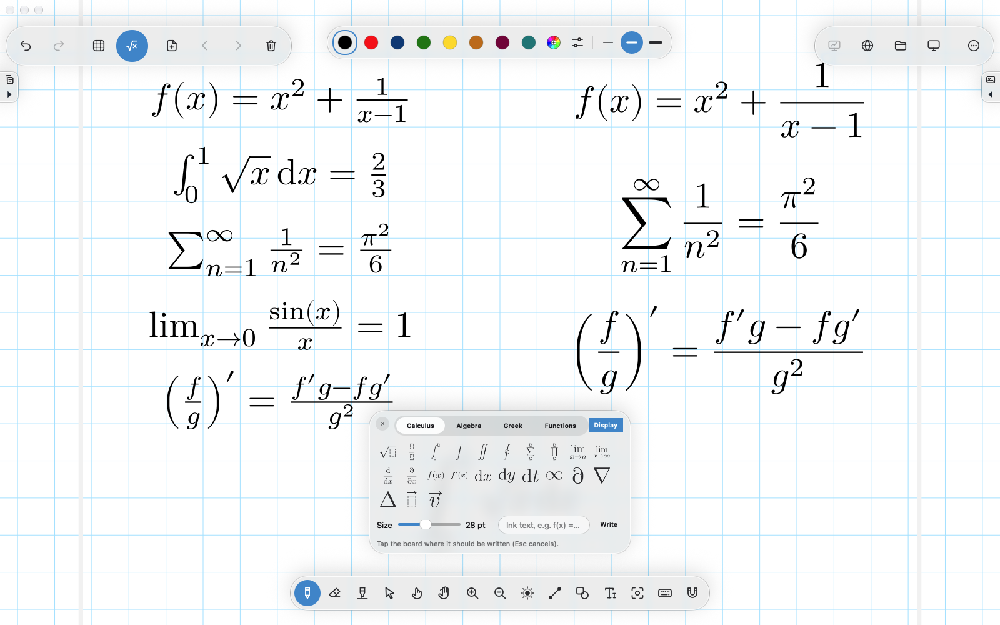
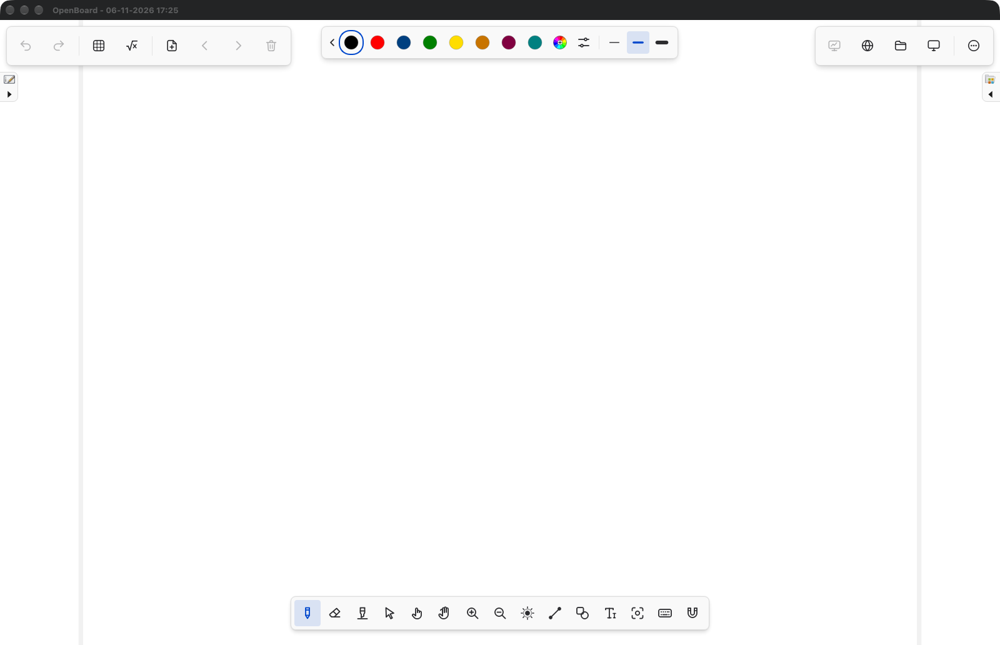
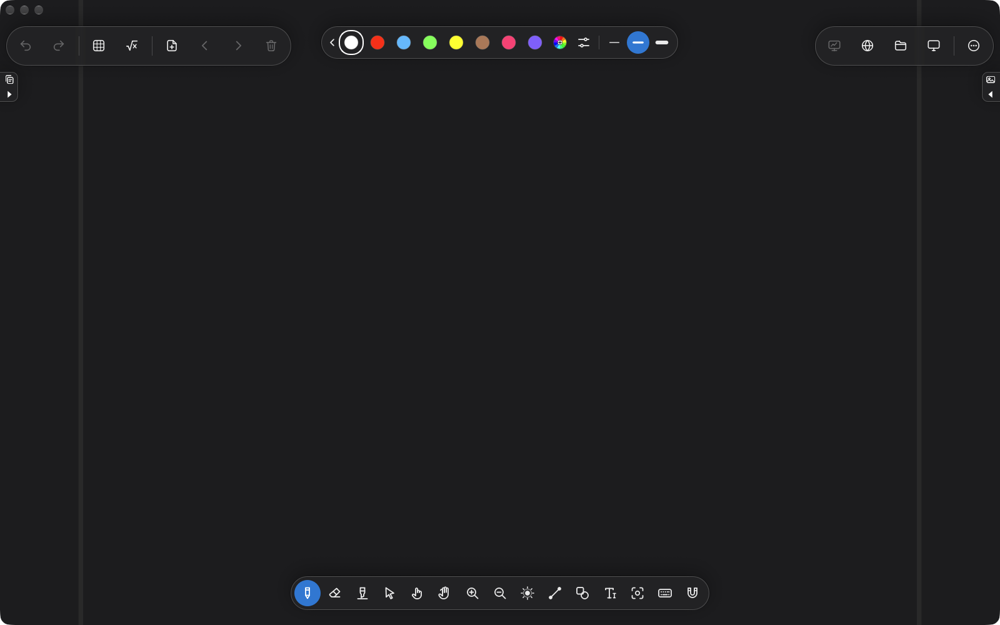
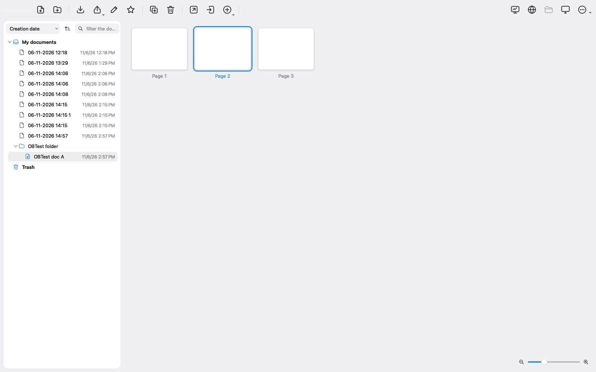

# OpenBoard-ML

OpenBoard-ML is a fork of [OpenBoard](https://github.com/OpenBoard-org/OpenBoard), the open source
interactive whiteboard for schools, with a modern flat user interface and a set of additions aimed at
teaching maths with a pen tablet. It is based on the upstream `dev` branch (1.8.0) and builds with the
same tools; no new dependencies.

| macOS (Liquid Glass) | Windows and Linux (modern style) |
|---|---|
|  |  |

| Dark appearance | Document mode |
|---|---|
|  |  |

## Added features

| Feature | Details |
|---|---|
| **Flat, floating UI**: no toolbar strip, the controls float over the board. Native Liquid Glass on macOS, a flat Fluent-like style on Windows and Linux. Light, dark or system appearance; in dark mode the board itself is dark. | [docs/UI-STYLES.md](docs/UI-STYLES.md) |
| **Maths notation typeset like LaTeX**: √, fractions, ∫ Σ Π with bounds, lim, brackets, Greek, functions. Written with the Latin Modern Math font and TeX's layout rules, as ink in the pen colour (erase, move, undo, PDF). Type formulas such as `int_0^1 sqrt(x) dx`. | [docs/MATHS.md](docs/MATHS.md) |
| **Any colour, several palettes**: colour wheel, hex/RGB, named palettes with 5–10 swatches, a chevron next to the swatches to switch palettes quickly. | [docs/FEATURES.md](docs/FEATURES.md#colours-and-palettes) |
| **Pen tablet and mouse shortcuts**: every command can get a key, a mouse button and a stylus button; right/middle click behaviour (temporary eraser, previous tool, pan); device profiles for Wacom Intuos M and Medion P82030. | [docs/INPUT-DEVICES.md](docs/INPUT-DEVICES.md) |
| **Backgrounds in real centimetres**: blank, lined, 1 cm and 0.5 cm grid, dark page; screen calibration. | [docs/BACKGROUNDS.md](docs/BACKGROUNDS.md) |
| **Shapes and text boxes**: rectangle, rounded rectangle, ellipse, triangle, line, arrow, fill; text boxes with border and background. | [docs/FEATURES.md](docs/FEATURES.md#shapes-and-text-boxes) |
| **Line angle readout**: while drawing a line the angle is shown next to the pen; lines within ±2° of horizontal or vertical become exactly straight, without snapping to the grid. | [docs/FEATURES.md](docs/FEATURES.md#line-angle) |
| **Normal window by default**, full screen with Ctrl+Shift+F; "Show on Second Screen" for a projector. Document mode restyled; no update check; startup hints off. | [docs/FEATURES.md](docs/FEATURES.md#user-interface-liquid-glass) |

All upstream OpenBoard features (documents, library, web mode, desktop annotation, podcast, PDF import
and export) are still there.

## Installing

Ready-made builds are published on the [Releases](../../releases) page of this repository.

### macOS

1. Download `OpenBoard.dmg` from the latest release (Apple Silicon; macOS 12 or newer, the glass
   effects need macOS 26).
2. Open the image and drag `OpenBoard` to `Applications`.
3. The app is not signed with an Apple developer certificate. The first time, right-click the app and
   choose **Open**, or run in Terminal:

   ```bash
   xattr -dr com.apple.quarantine /Applications/OpenBoard.app
   ```

### Windows

A Windows installer will be attached to a release once the Windows build of this fork has been
tested. Until then, build from source (below) or use the upstream
[OpenBoard installer](https://github.com/OpenBoard-org/OpenBoard/wiki/Downloads) without the
additions.

### Linux

No package yet; build from source (below). The upstream project maintains a Debian package of
plain OpenBoard on its [downloads page](https://github.com/OpenBoard-org/OpenBoard/wiki/Downloads).

## Building from source

The upstream wiki page [Build OpenBoard from source](https://github.com/OpenBoard-org/OpenBoard/wiki/Build-OpenBoard-from-source)
applies; both `CMakeLists.txt` and `OpenBoard.pro` list all added sources. Qt 6 is recommended
(Qt 5.15 still compiles).

### macOS

Requires Xcode (with the command line tools) and Homebrew.

```bash
brew install qtbase qtsvg qt5compat qtdeclarative qtwebengine qtmultimedia qttools \
             poppler quazip openssl@3 ffmpeg pkg-config
git clone https://github.com/<your-user>/OpenBoard-ML.git
cd OpenBoard-ML
qmake OpenBoard.pro -spec macx-clang CONFIG+=release
make -j8 release
open build/macx/release/product/OpenBoard.app
```

`OpenBoard.pro` finds the libraries in `/opt/homebrew`, `/usr/local` or `/opt/local` on its own
(override with `qmake OpenBoard.pro MAC_LIB_PREFIX=/some/prefix`). Qt from the Qt Online Installer
works too: use its `qmake` and add the modules *Qt WebEngine*, *Qt Multimedia* and *Qt 5 Compatibility*.
To make a distributable disk image: `macdeployqt build/macx/release/product/OpenBoard.app -dmg`.

### Windows

Requires Visual Studio 2022 (Desktop development with C++), Qt 6 (MSVC, with *Qt WebEngine*,
*Qt Multimedia* and *Qt 5 Compatibility*) and the third-party libraries of the upstream wiki
(poppler, QuaZip, OpenSSL, FFmpeg). In a *x64 Native Tools* prompt:

```bat
git clone https://github.com/<your-user>/OpenBoard-ML.git
cd OpenBoard-ML
C:\Qt\6.9.3\msvc2022_64\bin\qmake.exe OpenBoard.pro CONFIG+=release
nmake release
```

The modern style uses the Windows 11 Qt style when available and sets a dark title bar through
`DwmSetWindowAttribute` (`-lDwmapi`). This fork has not been compiled on Windows yet; please open
an issue with the output if the build fails.

### Linux (Debian 12 / Ubuntu)

```bash
sudo apt install build-essential cmake ninja-build qt6-base-dev qt6-base-private-dev \
     qt6-svg-dev qt6-5compat-dev qt6-declarative-dev qt6-webengine-dev qt6-multimedia-dev \
     qt6-tools-dev libpoppler-dev libpoppler-private-dev libquazip1-qt6-dev libssl-dev \
     libavcodec-dev libavformat-dev libswscale-dev libpipewire-0.3-dev libxkbcommon-dev
git clone https://github.com/<your-user>/OpenBoard-ML.git
cd OpenBoard-ML
cmake -S . -B build -G Ninja -DCMAKE_BUILD_TYPE=Release
cmake --build build -j8
sudo cmake --install build      # rulings and device profiles are read from the install prefix
openboard
```

Linux gets the same modern style as Windows. The Linux CMake build of this fork was last built
in a container during development and should be re-checked on a real system.

## Documentation

* [docs/FEATURES.md](docs/FEATURES.md): all additions, settings keys and the UI
* [docs/MATHS.md](docs/MATHS.md): maths typesetting rules and font
* [docs/INPUT-DEVICES.md](docs/INPUT-DEVICES.md): shortcuts, tablet buttons, device profiles
* [docs/BACKGROUNDS.md](docs/BACKGROUNDS.md): rulings in centimetres, calibration
* [docs/UI-STYLES.md](docs/UI-STYLES.md): glass and modern style, appearance

## Upstream

OpenBoard is developed by the [OpenBoard community](https://github.com/OpenBoard-org/OpenBoard);
it was originally forked from Open-Sankoré, itself based on Uniboard. This fork follows the upstream
`dev` branch. Web widgets, documentation and community packages of upstream OpenBoard apply unchanged.

## Licence

GNU General Public License v3, with the OpenSSL linking exception, like OpenBoard (see
[LICENSE](LICENSE) and [COPYRIGHT](COPYRIGHT)). The bundled Latin Modern Math font is distributed under
the GUST Font License (see `resources/math/`).
